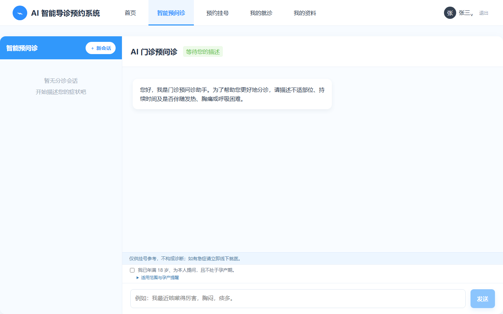
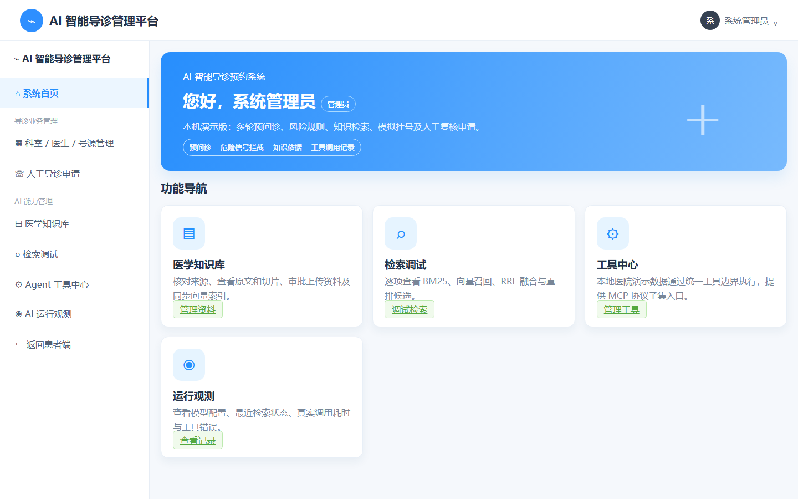
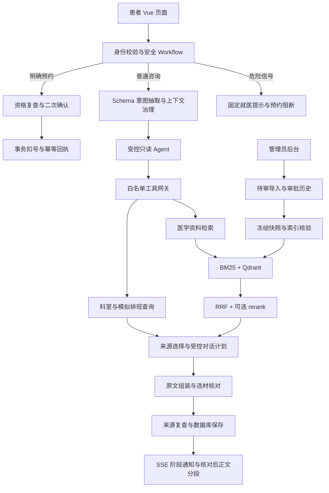

# LangChain4j 医疗导诊助手

**面向学习与二次开发的 Agent + Workflow 医疗导诊示例。**

[](https://github.com/Y3148y/Smart-Healthcare-System/actions/workflows/verify.yml)
[](backend/pom.xml)
[](backend/pom.xml)
[](frontend/package.json)
[](compose.app.yml)
[](LICENSE)

基于 **Java 17、Spring Boot、LangChain4j 与 Vue 3**，将多轮咨询、混合检索、受控工具调用、来源核对和模拟预约连接为一个可运行的应用。项目同时提供患者页面、管理员后台、知识导入工具和评估工具，便于理解模型能力与业务约束如何协作。

[快速开始](#快速开始) · [界面预览](#界面预览) · [系统架构](#系统架构) · [技术文档](#技术文档) · [参与贡献](#参与贡献)

> 本项目是开源示例，不是诊断、处方或医院上线方案。医学资料与安全规则未经专业临床审核，预约使用模拟号源，尚未接入真实 HIS。请勿将演示认证或开发服务暴露到公网，也不要录入真实患者信息。

## 目录

- [项目亮点](#项目亮点)
- [界面预览](#界面预览)
- [功能与角色](#功能与角色)
- [系统架构](#系统架构)
- [快速开始](#快速开始)
- [配置说明](#配置说明)
- [Docker 运行](#docker-运行)
- [知识库与评估](#知识库与评估)
- [开发与测试](#开发与测试)
- [项目结构](#项目结构)
- [技术文档](#技术文档)
- [常见问题](#常见问题)
- [已知限制与安全](#已知限制与安全)
- [参与贡献](#参与贡献)
- [许可证](#许可证)

## 项目亮点

| 设计 | 实现方式 |
| --- | --- |
| Agent + Workflow | 普通咨询由模型在白名单内选择只读工具；安全分流、权限与预约状态由后端工作流控制 |
| 混合 RAG | Elasticsearch/Lucene BM25 与 embedding/Qdrant 多路召回，RRF 融合，可选 rerank |
| 来源约束回答 | 模型选择引用与对话项，后端插入完整来源原文；严格校验引用身份、内容哈希、当前授权与完整段落 |
| 多轮上下文 | 最近最多5轮、累计≤4000字符；完整消息与证据按预算裁剪，结构化观察保留原话来源和版本 |
| 知识版本治理 | Markdown 元数据与来源绑定、待审导入、追加式审批历史、冻结快照、索引核验与CAS活动版本切换 |
| 业务可靠性 | 请求幂等、数据库事务、并发扣号约束、预约二次确认、过期轮次对账和断连后结果回读 |
| 调用可观测性 | 按 session / turn / trace 关联意图、工具、检索、模型用量、耗时、失败码和最终状态 |
| 可复现验证 | 离线测试、隔离数据库/索引集成、浏览器交互测试、检索与答案评分工具及 GitHub Actions |

这些是有明确边界的工程能力，不代表医学正确性、一般化质量或真实医院业务验收。

## 界面预览

下图来自本地演示账号，不包含真实患者数据。

| 患者端 · 智能预问诊 | 管理员端 · 业务与知识管理 |
| --- | --- |
|  |  |

## 功能与角色

| 角色 | 已有功能 |
| --- | --- |
| 患者 | 多轮咨询、来源查看、本人资料、会话历史、AI观察回看、模拟预约及就诊记录、人工导诊申请 |
| 系统管理员 | 科室/医生/排班管理、知识上传与审批/撤回、版本发布、检索调试、调用观测、人工申请处理 |
| 开发者 | 模型兼容接口适配、受控工具扩展、语料校验与导入、离线/集成测试、RAG评估与调用定位 |

AI观察记录不是正式病历；人工导诊申请不保证实时响应。当前没有独立医生工作台、医院SSO或真实HIS适配器。

## 系统架构



- **模型不直接执行业务写入。** Agent最多3次规划、4次只读工具执行；失败时工作流接管，不能由模型创建预约。
- **医学正文不自由改写。** 当前患者回答采用“来源原文＋受控对话引导”；相关性、适用条件和追问仍需一次模型核对，来源身份由代码校验。
- **正文先核对、后展示。** 供应商SSE在服务端有界缓存，完成检查和保存后才发送正文片段；不是逐token直出，也不承诺提前首字。
- **MCP与患者工具路径分开。** `/mcp`是管理员认证的2025-11-25无状态工具服务，已验证官方SDK互操作；患者Agent使用本地工具网关，不经MCP客户端，不实现OAuth。

### 技术栈

| 层 | 技术 |
| --- | --- |
| 后端 | Java 17、Spring Boot 3.5.16、MyBatis、Maven Wrapper |
| 模型 | LangChain4j 0.35.0、OpenAI-compatible API、有界HTTP/SSE适配器 |
| 数据与检索 | MySQL、Elasticsearch 8.17.6、Qdrant 1.12.1；H2仅供测试 |
| 前端 | Vue 3、TypeScript、Vite、Nginx |
| 测试与交付 | JUnit 5、Node.js Test Runner、浏览器测试、Docker Compose、GitHub Actions |

默认BM25使用ES内置CJK分析器和标题/正文字段，未配置IK或医学词典；轻量/离线测试可显式使用内存BM25。两种实现不保证相同排序。详细职责与一致性边界见[架构说明](docs/ARCHITECTURE.md)。

## 快速开始

### 1. 环境准备

| 依赖 | 要求 |
| --- | --- |
| JDK | 17，运行前检查 `JAVA_HOME` |
| Node.js | 20+，使用 `npm ci` 安装锁定依赖 |
| Docker Compose | 用于本机MySQL、Qdrant与ES；也可使用已有服务 |
| 模型服务 | 真实模式需兼容聊天接口与有效凭据；向量检索另需embedding能力 |

```shell
git clone https://github.com/Y3148y/Smart-Healthcare-System.git
cd Smart-Healthcare-System
```

以下启动示例使用PowerShell；Linux/macOS使用对应环境变量语法与 `./mvnw`。密钥只通过进程环境注入，不写入仓库、前端变量或含凭据的IDE配置文件。

### 2. 配置数据库与模型

在同一终端安全读取数据库密码与模型密钥：

```powershell
function Read-ProcessSecret([string]$Prompt) {
    $value = Read-Host $Prompt -AsSecureString
    $pointer = [Runtime.InteropServices.Marshal]::SecureStringToBSTR($value)
    try { [Runtime.InteropServices.Marshal]::PtrToStringBSTR($pointer) }
    finally { [Runtime.InteropServices.Marshal]::ZeroFreeBSTR($pointer); $value.Dispose() }
}

$env:AI_DB_USER = 'root'
$env:AI_DB_PASSWORD = Read-ProcessSecret 'MySQL password'
$env:AI_BASE_URL = Read-Host 'OpenAI-compatible base URL'
$env:AI_API_KEY = Read-ProcessSecret 'Model API key'
$env:MYSQL_ROOT_PASSWORD = $env:AI_DB_PASSWORD
```

聊天模型默认 `qwen3.7-flash-2026-07-15`，embedding默认 `qwen3.7-text-embedding`；这是项目配置，不保证你的供应商或账户支持。按实际服务设置 `AI_MODEL`、`AI_EMBEDDING_MODEL`，embedding地址和密钥默认继承聊天配置。更换向量模型/维度后须重建索引，不能直接复用旧向量。

只想查看界面和确定性演示流程时，可跳过模型变量并显式设置 `$env:AI_MODE='demo'`。demo不调用外部LLM，不能用于真实模型或语义检索质量验收。日常默认是真实模式，缺少必要配置会报错，不自动退为demo。

### 3. 启动开发依赖

```powershell
docker compose up -d mysql qdrant elasticsearch
docker compose ps
```

Compose创建 `ai_hospital` 数据库并保留数据卷。已有MySQL时只启动 `qdrant elasticsearch`，另在已有数据库服务执行：

```sql
CREATE DATABASE IF NOT EXISTS ai_hospital
  CHARACTER SET utf8mb4 COLLATE utf8mb4_unicode_ci;
```

应用启动会初始化表，不自动迁移历史H2数据。ES关闭认证仅用于本机开发；这些服务的发布端口绑定回环地址，不要暴露公网。

### 4. 启动后端

在已设置上述环境变量的终端：

```powershell
cd backend
.\mvnw.cmd spring-boot:run
```

IDEA可直接运行 `HospitalApplication`，选择JDK17并在运行配置中一次性设置相同环境变量。无需每天切换profile、模式或端口；IDE变量不会自动传给另开的终端。默认后端地址为 `http://127.0.0.1:8081`。

### 5. 启动前端

另开终端，从仓库根目录执行：

```powershell
cd frontend
npm ci
npm run dev
```

打开 [本机页面](http://127.0.0.1:5188)。前端默认代理8081，端口占用会报错，不自动换端口。

| 服务 | 本机默认地址 |
| --- | --- |
| 前端 | `http://127.0.0.1:5188` |
| 后端 | `http://127.0.0.1:8081` |
| 存活 / 就绪检查 | `/api/health/live` / `/api/health/ready`（后端端口） |
| Elasticsearch | `http://127.0.0.1:9201` |
| Qdrant | `http://127.0.0.1:6333` |
| MySQL | `127.0.0.1:3306` |

演示账号：患者 `zhangsan`、`lisi`，管理员 `admin`；密码接受任意非空字符串。**这不是正式身份认证。** URL里的 `demo=patient` 是演示身份入口，不决定后端是否调用模型。

## 配置说明

配置事实源为 [application.yml](backend/src/main/resources/application.yml)。默认真实模型、启用只读Agent、关闭rerank；不需要额外启用 `rag-live` profile。

| 环境变量 | 说明 |
| --- | --- |
| `AI_DB_USER` / `AI_DB_PASSWORD` | 必填数据库凭据；`AI_DB_URL`可覆盖默认本机数据库 |
| `AI_BASE_URL` / `AI_API_KEY` / `AI_MODEL` | 模型兼容接口、密钥、模型ID |
| `AI_EMBEDDING_BASE_URL` / `AI_EMBEDDING_API_KEY` / `AI_EMBEDDING_MODEL` | 向量模型配置，地址/密钥可继承聊天配置 |
| `AI_QDRANT_URL` / `AI_QDRANT_COLLECTION` | 默认6333 / `ai_hospital_knowledge_v2`，不自动迁移旧集合 |
| `AI_LEXICAL_BACKEND` | 默认 `elasticsearch`；显式 `memory`用于轻量模式 |
| `AI_ELASTICSEARCH_URL` / `AI_ELASTICSEARCH_API_KEY` | 默认本机9201；远端接口须HTTPS |
| `AI_AGENT_MODE` | `ENABLED`、`SHADOW`或`OFF`；关闭不取消安全工作流 |
| `AI_RERANK_ENABLED` | 默认 `false`；启用需配置 `AI_RERANK_URL` / `MODEL` / `API_KEY` |
| `AI_RETRIEVAL_REQUIRE_SEMANTIC` / `AI_RETRIEVAL_REQUIRE_RERANK` | 普通配置默认均false；可选 `rag-live`仅前者默认true |
| `AI_CONTEXT_INPUT_TOKEN_BUDGET` / `AI_TURN_INPUT_ESTIMATE_BUDGET` | 单次/本轮输入估算预算，不是供应商实际Token或计费配额 |
| `AI_STREAM_RESPONSE` | 默认true，接收供应商SSE；正文仍先核对、保存 |
| `AI_MODE` | 默认 `openai-compatible`；显式 `demo`为离线演示 |
| `SERVER_PORT` / `VITE_API_PROXY_TARGET` | 默认8081 / `http://127.0.0.1:8081` |

临时跳过重排时同时确保 `AI_RERANK_ENABLED=false`、`AI_RETRIEVAL_REQUIRE_RERANK=false`。未开启、未执行和执行失败会分别记录，不能沿用开启重排时的评分。

旧 `AI_ANSWER_REVIEW_REQUIRE_CLAIM_PROOF` 默认true，保留自由草稿证明路径并影响核对输出预算；主患者原文计划使用专用强制选材核对，此开关不能跳过引用绑定或语义检查。超时、思考参数、阈值及预算边界见[Agent文档](docs/AGENT.md)与[RAG文档](docs/RAG.md)。密钥不得设置为 `VITE_*`，后者可能进入浏览器产物。

## Docker 运行

已有上面的数据库和模型环境变量时，可从根目录运行全栈：

```powershell
$env:MYSQL_ROOT_PASSWORD = $env:AI_DB_PASSWORD
$env:AI_DEMO_LOCAL_CONTAINER = 'true'
docker compose -f docker-compose.yml -f compose.app.yml up -d --build --wait
```

不要与占用8081/5188的IDEA/Vite同时运行。前后端采用多阶段构建；运行镜像分别为JRE应用和Nginx静态站点，不复制本机密钥、缓存或患者数据。

- `AI_DEMO_LOCAL_CONTAINER`是本机Docker演示绑定例外，不改变LLM模式，也不是公网部署许可；切回宿主机启动时移除该覆盖。
- 容器发布端口绑定127.0.0.1。ES仅本机开发关闭认证；有Docker管理权限的人员仍可能读取容器环境。
- 后端非root运行；存活检查检查进程，就绪检查仅探测数据库，不证明模型、ES和Qdrant可用。
- 应用容器配置 `unless-stopped`，健康检查失败本身不会触发重启；未实现Kubernetes或OOM恢复验收。

## 知识库与评估

### 知识生命周期

```text
登记来源与许可 → 采集/清洗 → Markdown正文 + 来源元数据/哈希
→ 校验与待审导入 → 审批历史 → 冻结发布快照
→ 按章节/段落切分 → ES倒排与embedding/Qdrant索引 → 核验并激活
```

11篇公开示例位于 [knowledge/corpus](knowledge/corpus)，按症状主题分目录，每篇含正文、元数据与必要来源文本。当前资料可由实际切分器得到78个片段；不会为展示overlap而人为扩充正文。在线问答检索数据库中的获准资料，不通过来源URL临时抓网页。

公开原件的 `permissionStatus=pending` 不因开源自动获批，也不会随启动导入。维护者授权的**隔离本机测试准入**见[导入工具](tools/knowledge-sync/README.md)；测试库READY不表示临床审核或真实患者发布许可。管理员上传及资产格式见[知识目录说明](knowledge/README.md)。

```powershell
# 仓库根目录：离线校验正文与来源指纹，不调用模型
node tools/knowledge-sync/validate-document.mjs --corpus

# backend已编译且使用JDK17：通过应用实际切分器检查片段
java --class-path backend/target/classes tools/knowledge-sync/ChunkInspection.java knowledge/corpus
```

### 如何衡量质量

评估分别记录候选召回、最终片段排序、来源引用、答案支持、处置与用量/耗时；不把检索相似度当作模型置信概率，也不把工具测试当作医学成绩。

| 已有记录 | 结果与边界 |
| --- | --- |
| AI辅助检索基线 | 13题开发集＋12题排序未见验证集，共1950个片段判断；验证集Recall@3为87.88%、返回片段精度48.48%，不是人工金标或临床指标 |
| 当前原文契约实测 | 两条固定合成问答各一次均通过百炼选材核对及独立AI辅助来源复核；约20.76秒/14.32秒，展示与落库一致；不作为性能收益实验 |
| 原文一致性评分 | 两答案共4个完整引文块，`sourceQuotedFaithfulness=1`；自由生成分母0、忠实度null，不代表选材在其他问题上正确 |
| 历史自由生成评估 | 保留支持关系扩写和核对漏检记录，不与当前原文复制指标混算，不追认为误杀 |

两轮原文回答重复相同资料，表达仍有限。临床正确性和置信度校准未知；完整分母、冻结快照与历史限制见[RAG设计与评估](docs/RAG.md)。

## 开发与测试

默认测试不需要外部模型密钥；运行前使用JDK17，并移除当前测试终端的 `AI_*` 覆盖，避免把日常真实模型配置带入测试。测试资源使用内存测试库和模型桩，不操作日常8081。

```powershell
cd backend
.\mvnw.cmd test
cd ../frontend
npm ci
npm test
npm run build
cd ..
node scripts/check-public-files.cjs
node scripts/check-public-content.cjs
```

```powershell
# 独立工具测试
cd tools/knowledge-sync
npm ci
npm test
cd ../rag-eval
npm test
```

Maven Wrapper固定3.9.16并校验发行包SHA-256，首次运行需下载依赖。Node锁文件使用官方npm HTTPS地址和完整性哈希；离线运行仍需已缓存依赖。

[GitHub Actions](.github/workflows/verify.yml)覆盖常规测试、隔离MySQL/ES/Qdrant集成、官方MCP客户端及部分容器/浏览器业务链。详细命令和数据边界见[测试入口矩阵](CONTRIBUTING.md#测试入口)。真实模型、写入探针和ANN对照需显式启用；会消耗额度或留下合成数据的脚本只能在明确隔离的测试实例执行，不针对共用患者库。

断连恢复是按requestId/turn回读已保存结果，不是SSE事件队列补发。预约准备不占号，确认时重新验证并事务扣号；并发与跨进程测试验证数据库一致性，不是吞吐量或真实HIS性能报告。

## 项目结构

```text
.
├── backend/                  Spring Boot后端、领域端口、适配器与JUnit测试
├── frontend/                 Vue患者端、管理员后台与组件测试
├── knowledge/                示例语料、来源元数据与独立许可
│   └── corpus/               按症状主题组织的11篇公开示例
├── tools/
│   ├── knowledge-sync/       来源登记、采集清洗、校验与待审导入
│   ├── rag-eval/             检索评估、答案审核包与评分
│   └── mcp-client/           官方MCP客户端互操作验证
├── scripts/                  维护、公开范围及集成/浏览器验证入口
├── docs/                     架构、Agent、RAG说明与演示截图
├── .github/workflows/        CI工作流
├── docker-compose.yml        本机MySQL、Qdrant、Elasticsearch
├── compose.app.yml           可选前后端容器覆盖
├── CONTRIBUTING.md           贡献规范与测试矩阵
└── LICENSE                   Apache-2.0代码许可证
```

后端按 `identity / triage / knowledge / catalog / booking / patient / review / observation / tools` 划分业务模块，采用 `api → application → domain` 与 `infrastructure` 适配层；不是多个独立微服务。

## 技术文档

| 文档 | 适合阅读的内容 |
| --- | --- |
| [架构与业务边界](docs/ARCHITECTURE.md) | 模块职责、事务、预约与轮次一致性、安全边界 |
| [Agent与工作流](docs/AGENT.md) | Schema抽取、受控工具、上下文、MCP、失败与观测 |
| [RAG设计与评估](docs/RAG.md) | 切分、索引、BM25/Qdrant、RRF、选材核对、质量分母 |
| [知识资产](knowledge/README.md) | 目录与元数据格式、管理员上传、审核状态 |
| [来源采集与导入](tools/knowledge-sync/README.md) | 来源许可、清洗校验、待审导入和测试准入 |
| [贡献指南](CONTRIBUTING.md) | 测试入口、分支规范、公开范围与提交要求 |

## 常见问题

**URL有 `demo=patient`，是否就没有调用模型？** 不是。它指定演示身份入口；后端 `AI_MODE` 和本轮路径决定是否调用LLM。调用详情区分模型、工具与后端流程。

**没有rerank还能检索吗？** 可以。BM25与向量候选仍可经RRF融合，重排默认关闭；故障与当前是否强制依赖分别记录，不能伪称已重排。

**检索不到资料是否让LLM自行补医学答案？** 当前主患者医学回答不会。无资料、未选用资料、核对失败与来源失效分别处理；特定支持拒绝可展示已核验原文摘录，但不恢复被拒草稿或本轮预约权限。

**为什么模型流已经开启，正文仍要等待？** 未核对的医学草稿不直接外发；先显示处理阶段，核对及保存后发送正文分段。这是当前安全取舍，不是逐token流式体验。

**管理员是否能直接批准仓库里的资料？** 公开原件待审，需先解决使用权限并按工具/后台流程核验。隔离测试准入与临床审核、真实患者发布是三件不同的事。

## 已知限制与安全

- 当前为开源开发示例，没有正式病历、医生工作台、医院SSO或真实HIS连接；人工导诊无实时响应保证。
- 安全规则和中文映射未经临床审核；非标准表达、主体和时间归属仍有已记录缺口，未命中不能排除急症。
- 模型核对来自同一已配置供应商的另一次请求，不是独立临床审核，仍可能误判。原文复制一致也不证明医学内容正确或适用。
- 模型、embedding和可选重排分别受供应商权限、额度、接口与超时影响。就绪检查成功不代表这些外部服务正常。
- 密钥、患者数据、运行日志、来源缓存和本机评估报告不公开；路径与凭据形态检查不能替代完整安全审计。

<details>
<summary>依赖公告与安全核查边界</summary>

2026-10-16的运行依赖版本核对记录了Spring MVC 6.2.19的 `GHSA-pc63-qcmh-9cmg`（XSLT视图）与 `GHSA-j9f9-w8pj-32f8`（SSE视图片段）两条公告。应用当前不使用相应视图路径，并用 `ServerRenderingBoundaryTest` 约束这一边界；这不消除公告或代替安全复核。

可选OSV检查仅发送依赖名称/版本，需显式 `--online`；不可将查询失败当作零告警。前端可运行 `npm audit --registry=https://registry.npmjs.org --audit-level=moderate`。这些检查不覆盖所有插件、容器基础镜像、操作系统或业务漏洞，也不是安全认证。

发现可能涉及密钥或患者数据的问题时，请勿在公开Issue粘贴原始日志、凭据、对话或数据库导出；先移除敏感内容，再提供最小复现。

</details>

## 参与贡献

欢迎提交可复现的问题、测试、文档改进与范围明确的PR。提交前阅读[贡献指南](CONTRIBUTING.md)，先确认现有设计和对应模块，再说明修改目的、验证方式及已知限制。

1. 使用功能或修复分支，保持一次PR聚焦一个明确问题。
2. 补充对应测试并同步文档；不要将demo、夹具或框架能力包装为真实模型成绩。
3. 运行相关测试与公开范围检查，仅提交必要路径。
4. 医学语料另行核实许可和来源，不因代码PR获准就视为医学发布获批。

问题反馈请使用[Issues](https://github.com/Y3148y/Smart-Healthcare-System/issues)，包含环境、复现步骤、期望/实际行为与脱敏信息。CI徽章只反映自动化检查，不是医学或安全认证。

## 许可证

原创代码与技术文档按 [Apache License 2.0](LICENSE) 发布。医学正文、来源快照及来源记录适用独立的[资料许可与署名说明](knowledge/LICENSE.md)，不因根目录许可证变为Apache-2.0；第三方依赖保留各自许可。

代码开源不代表医学审核通过、患者端使用许可或医院上线授权。
